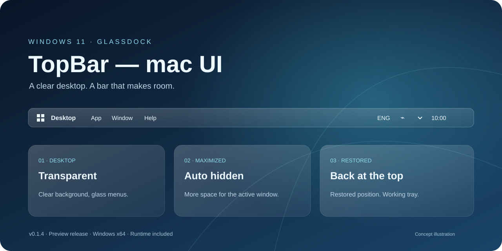
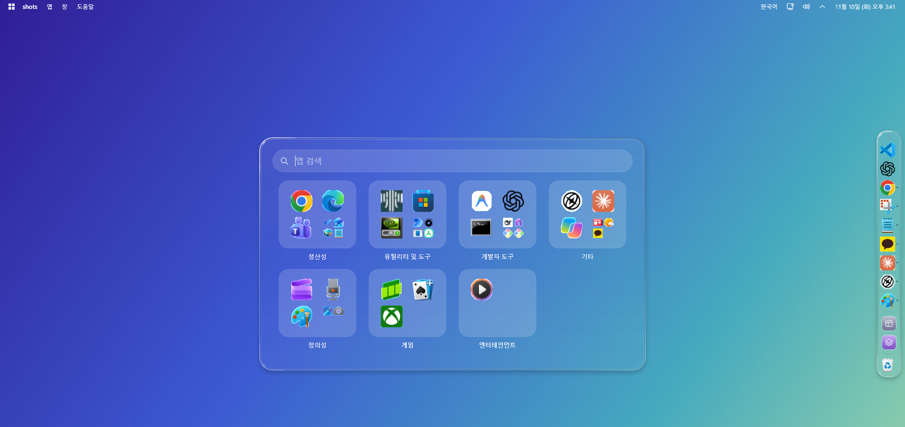
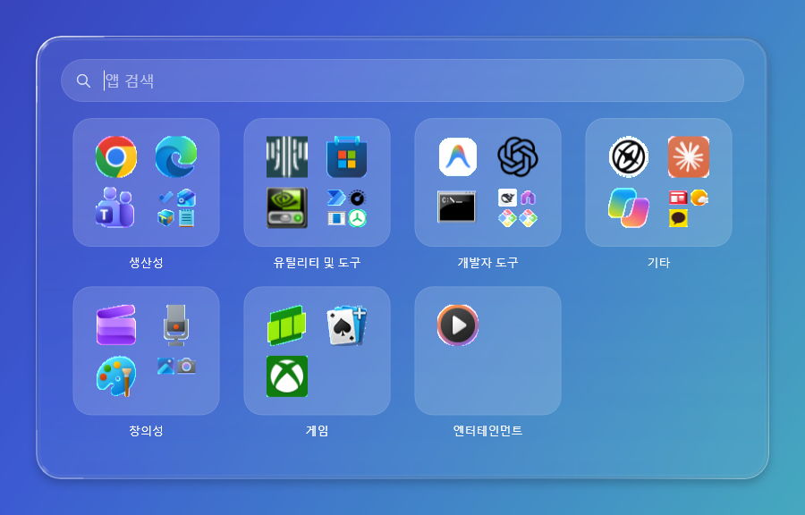
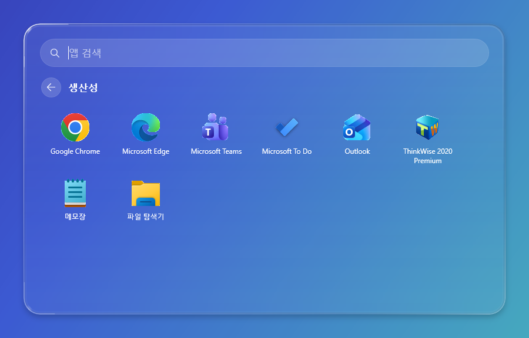
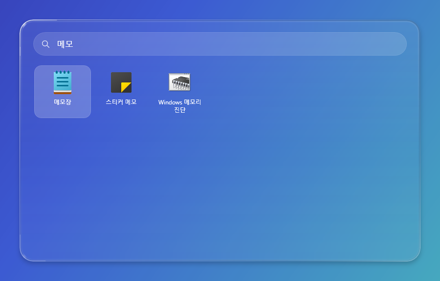
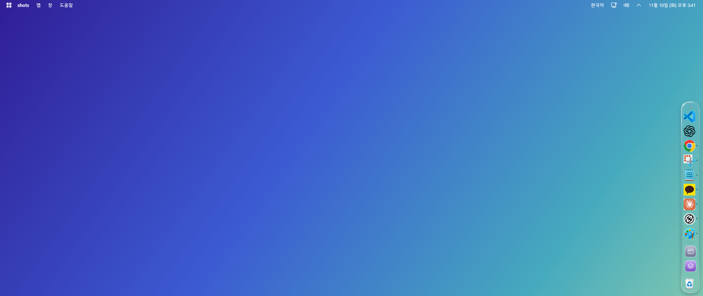

# Windows 11 TopBar — mac UI

*상단 바의 구성과 상태 전환을 표현한 설명용 이미지입니다. 실제 실행 화면은 아래 [완성 화면](#완성-화면)에 있습니다.*

**익숙한 Windows 위에 투명한 상단 바와 유리 메뉴를 더합니다.**

GlassDock TopBar는 Windows 11에서 독립 실행되는 상단 바입니다. macOS에서 영감을 받은 간결한 구성에 Windows 시스템 메뉴, 현재 앱 이름, 소리와 네트워크, 날짜·시간을 담았습니다. [GlassDock 독](https://github.com/SeA9612/windows11-glass-dock-mac-UI)과 함께 사용할 수 있으며, 독 설치 없이도 실행됩니다.

[**실행용 ZIP 다운로드 · v0.1.4**](https://github.com/SeA9612/windows11-top-bar-mac-UI/releases/download/v0.1.4/GlassDock-TopBar-v0.1.4-win-x64.zip) · [GitHub Release](https://github.com/SeA9612/windows11-top-bar-mac-UI/releases/tag/v0.1.4) · [변경 이력](Release%20Notes/README.md)

## 주요 기능

| 기능 | 소개 |
|---|---|
| 투명한 상단 바 | 일반 창·바탕화면에서는 배경 띠와 경계선 없이 투명하게 표시 |
| 최대화 자동 숨김 | 최대화·전체 화면에서는 숨기고 예약 공간 해제, 복원·최소화 시 다시 표시 |
| 가장자리에서 열기 | 최대화 중 화면 위쪽에 마우스를 잠시 올리면 표시, 메뉴·트레이를 사용하는 동안 유지 |
| Windows 시스템 메뉴 | PC 정보, 설정, Store, 최근 항목, 작업 관리자, 절전·재시동·종료·잠금·로그아웃 |
| 실제 상태와 제어 | 전경 앱 이름, 창 조작, 키보드 언어, 네트워크, 음량·음소거, 배터리, 시계·달력 |
| 투명 유리 메뉴 | 독과 같은 흐림, 옅은 색조, 반사광과 그림자. 분홍색 선택 효과 없음 |
| 유리 시작 화면 | Windows 키로 화면 가운데에 검색창과 앱 범주를 여는 독 스타일 유리 시작 화면 |
| 작업 표시줄 숨김 | 실행 중 Windows 작업 표시줄을 완전히 숨기고 그 자리를 화면으로 사용, 종료 시 원래 설정 복원 |
| 트레이·알림 연동 | Explorer 트레이 창과 Windows 알림 호스트의 위치 연동 구현. 아래 제한 확인 필요 |

## 완성 화면

| 범주 | 범주 열기 | 검색 |
|---|---|---|
|  |  |  |

*실제 실행 화면입니다. 개인 창이 찍히지 않도록 단색 그라데이션 배경 위에서 촬영했고, 오른쪽은 함께 사용하는 GlassDock 독입니다.*

## 다운로드하고 바로 실행하기

Windows 11 **x64**용입니다. .NET 런타임이 포함되어 있어 SDK·런타임 설치나 소스 빌드가 필요하지 않습니다.

1. 위 **실행용 ZIP 다운로드**를 누릅니다.
2. ZIP의 **전체 압축을 풉니다**.
3. 기존 상단 바가 실행 중이면 종료하고 `GlassDock.TopBar.exe`를 실행합니다.

EXE와 같은 폴더의 DLL·런타임 파일을 함께 보관하세요. ZIP 안에서 직접 실행하거나 EXE만 분리해 이동하지 마세요. 자동 시작이나 관리자 권한을 요구하지 않습니다. 실행하는 동안 Windows 작업 표시줄이 숨겨지며, 종료하면 돌아옵니다.

기존 독 저장소와 같이 **Code → Download ZIP**으로 전체 저장소를 받을 수도 있습니다. 이 경우 `windows11 top bar mac UI/portable/GlassDock-TopBar-v0.1.4-win-x64.zip`을 한 번 더 풀고 실행하세요.

자세한 안내와 체크섬은 [실행·소스 폴더](windows11%20top%20bar%20mac%20UI/README.md)에 있습니다.

## 이번 배포의 수정 사항

현재 버전은 **0.1.4 미리보기 배포본**입니다.

- **유리 시작 화면:** 상단 바가 켜져 있는 동안 Windows 키를 누르면 기본 시작 메뉴 대신 화면 가운데에 유리 시작 화면이 열립니다. 위쪽 검색창과 앱 범주 칸(생산성, 유틸리티 및 도구, 개발자 도구 등)으로 구성되고, 독과 같은 유리 재질이며 뒤 화면 밝기에 따라 글자색이 바뀝니다. Win+E 같은 조합 키는 그대로 동작하고, 기본 시작 메뉴는 Ctrl+Esc로 열 수 있습니다.
- 0.1.3의 작업 표시줄 완전 숨김과 트레이 수정은 그대로 유지합니다.

기본 검사 72개, 유리 시작 화면 검사 35개(연속 5회), 작업 표시줄·트레이·최대화 자동 숨김 검사가 통과했습니다. 상세 내용은 [0.1.4 릴리즈 노트](Release%20Notes/Release%20Note0.1.4%20ver.md)를 참고하세요.

## 현재 확인된 제한

- 상단 바가 켜져 있는 동안에는 Windows 작업 표시줄을 쓸 수 없습니다. Windows 키는 유리 시작 화면을 열고, 기본 시작 메뉴는 Ctrl+Esc로 열 수 있습니다.
- 유리 시작 화면의 범주는 Windows가 분류 방식을 공개하지 않아 이름·앱 ID 규칙으로 나눕니다. 규칙에 없는 앱은 "기타"에 들어갑니다. 관리자 권한 창이 맨 앞에 있을 때는 Windows 보안 규칙상 기본 시작 메뉴가 열릴 수 있습니다(미검증).
- 보조 모니터 작업 표시줄, 탐색기 재시작 후 다시 숨기기, 실제 로그오프·재부팅 후 복원은 이번 배포에서 실제로 검증하지 않았습니다.
- Windows 알림 위치 조정은 구현되어 있으나, 이번 수정 후 실제 배너 수신·배치를 다시 검증하지 못했습니다. 카카오톡 자체 알림은 각 PC의 카카오톡에서 우상단 위치를 따로 설정해야 합니다.
- 다른 DPI 장치와 다른 PC의 실제 화면 동작은 검증하지 않았습니다. 다른 앱의 파일·편집 메뉴를 옮기는 범용 기능은 없습니다.

실행에 필요한 파일은 모두 포함했습니다. 위 항목은 런타임 설치 문제와 별개인 현재 기능 검증 범위입니다. 개인 설정, 대화 원문, 알림 내용, 실행 로그와 사용자 화면 이미지는 업로드하지 않습니다.
