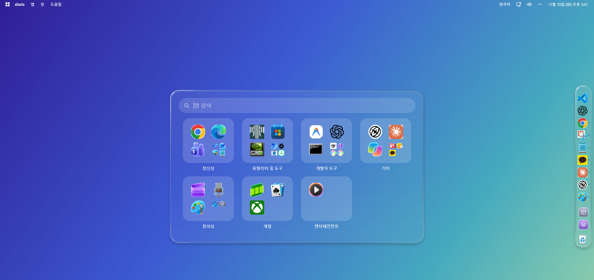
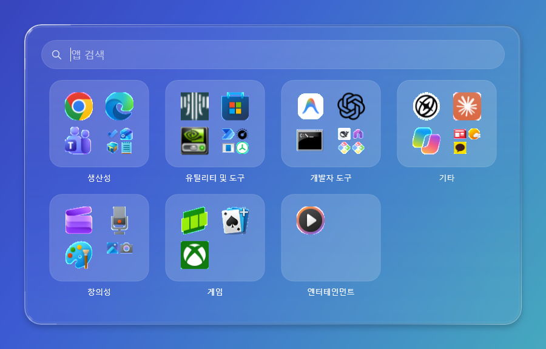
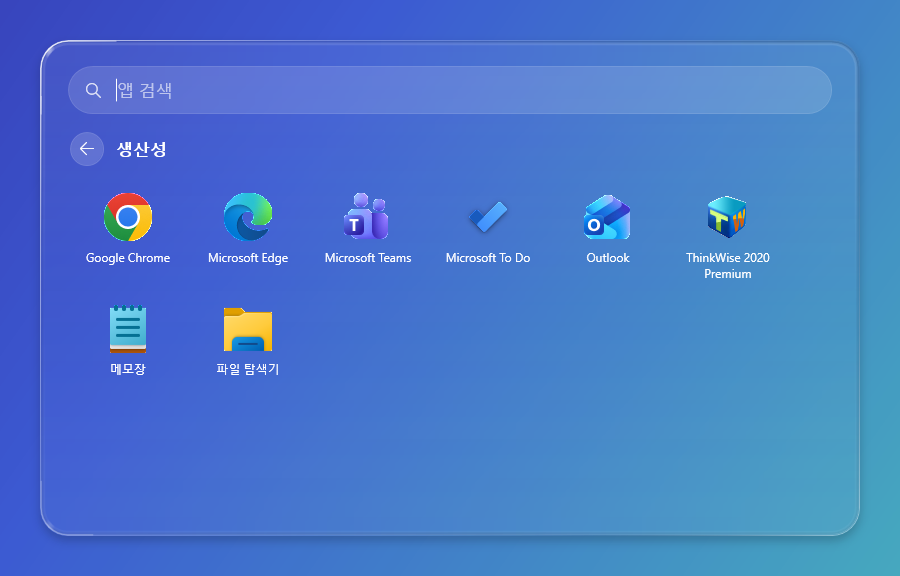
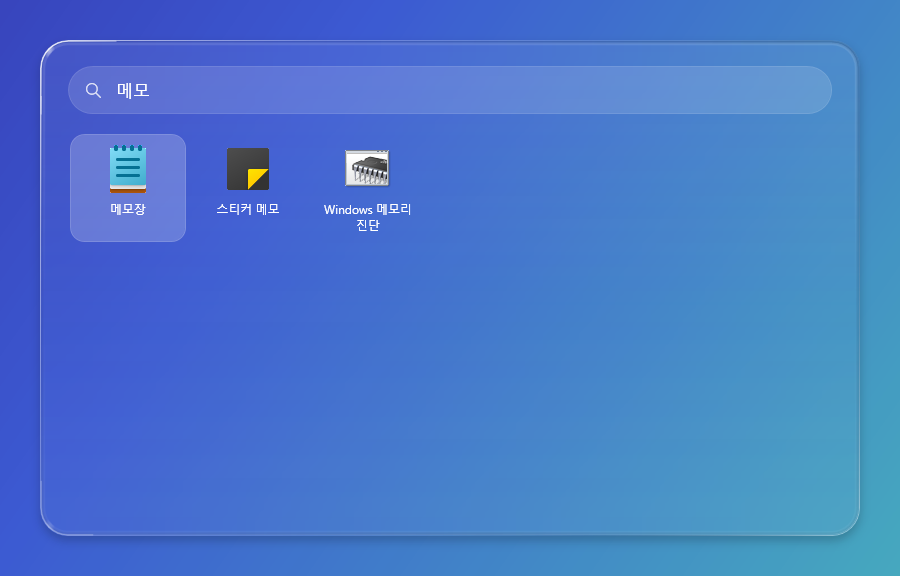

# Release Note0.1.4 ver — Windows 키로 여는 유리 시작 화면

배포일: **2026-11-10, 한국 시간**. 제품 버전: **0.1.4**. Git 태그: `v0.1.4`.

[런타임 포함 실행 ZIP 다운로드](https://github.com/SeA9612/windows11-top-bar-mac-UI/releases/download/v0.1.4/GlassDock-TopBar-v0.1.4-win-x64.zip)

ZIP의 전체 압축을 풀고 `GlassDock.TopBar.exe`를 실행합니다. Windows 11 x64용이며 .NET·SDK 설치나 소스 빌드가 필요하지 않습니다. 기존 상단 바가 켜져 있으면 종료한 뒤 새 실행본을 사용하세요.

## 새 기능: 유리 시작 화면

상단 바가 켜져 있는 동안 **Windows 키**를 누르면 기본 시작 메뉴 대신 화면 가운데에 유리 시작 화면이 열립니다. 다시 누르면 닫힙니다.

| 범주 | 범주 열기 | 검색 |
|---|---|---|
|  |  |  |

- **구성:** 위쪽 검색창과 범주 칸 4열입니다(생산성, 유틸리티 및 도구, 개발자 도구, 기타, 창의성, 게임, 엔터테인먼트). Windows 11 시작 메뉴의 "모두 · 보기: 범주"와 같은 구성입니다.
- **실행:** 칸 안의 앱 아이콘을 누르면 바로 실행되고, 칸이나 칸 이름을 누르면 그 범주의 앱 전체가 보입니다.
- **검색:** 글자를 입력하면 앱을 찾습니다. Enter로 실행하고 방향키로 고릅니다.
- **닫기:** Esc는 검색 지우기 → 범주에서 돌아가기 → 닫기 순서로 동작합니다. 다른 창을 눌러도 닫힙니다.
- **디자인:** 독과 같은 유리 재질(흐림, 옅은 색조, 가장자리 반사, 그림자)입니다. 창 높이는 범주 줄 수에 맞추고, 뒤 화면이 밝으면 어두운 글자, 어두우면 흰 글자로 열린 동안에도 바뀝니다.
- **키:** Win+E, Win+D 같은 조합 키는 그대로 동작합니다. 기본 Windows 시작 메뉴는 **Ctrl+Esc**로 열 수 있습니다. 상단 바를 종료하면 Windows 키는 원래대로 돌아갑니다.
- **앱 목록:** Windows의 앱 목록에서 읽습니다. 웹 링크·도움말·제거 프로그램은 빼고, Windows 관리 도구는 범주에는 넣지 않되 검색으로 찾을 수 있습니다. Windows가 범주 분류 방식을 공개하지 않아 이름·앱 ID 규칙으로 나누며, 규칙에 없는 앱은 "기타"에 들어갑니다.

## 개발 중 찾아서 고친 문제

- **이름 정렬:** .NET의 한국어 정렬은 한글 이름을 영문보다 앞에 둡니다. Windows 시작 메뉴처럼 영문(A–Z) 다음 한글(ㄱ–ㅎ) 순서로 맞췄습니다.
- **어두운 배경의 글자:** 열린 동안 뒤 화면이 어두워지면 짙은 글자가 보이지 않던 문제를 고쳤습니다. 0.4초마다 유리 밝기를 다시 읽어 글자색을 바꿉니다.
- **열리는 순간 포커스 이동:** 시작 화면이 열리는 순간 다른 창이 앞으로 오면, 포커스 없는 화면이 맨 위에 남지 않고 닫힙니다.
- **실행 실패 안내:** 앱 실행에 실패해 안내 창이 뜰 때 시작 화면이 먼저 닫혀 버리지 않습니다.

## 검증 결과

| 항목 | 결과 |
|---|---|
| 단위 검사(앱 분류·검색·정렬·목록 제외 규칙 포함) | 72개 통과 |
| 유리 시작 화면 통합 검사 | 35개, 연속 5회 통과 |
| 기본 시작 메뉴 안 열림 | 화면 픽셀 비교로 확인. 열리면 15/15 지점이 바뀌는 것을 Ctrl+Esc로 매번 먼저 검증 |
| 작업 표시줄·트레이·최대화 자동 숨김 | 기존 검사 모두 통과 |
| 실제 화면 | Windows 키 열기·닫기, 검색, 범주 클릭, Esc 단계 확인 |

이 Windows 11(25H2)에서는 시작 메뉴 창이 창 목록에 나오지 않고 닫혀도 창 상태가 바뀌지 않습니다. 그래서 "기본 시작 메뉴가 열렸는지"는 화면 아래쪽에 깐 단색 판의 픽셀이 바뀌는지로 판단했습니다.

상세 기록: [0.1.4 검증](https://github.com/SeA9612/windows11-top-bar-mac-UI/blob/main/windows11%20top%20bar%20mac%20UI/source/validation/유리시작화면_0.1.4_2026-11-10.md), [패키지 검증](https://github.com/SeA9612/windows11-top-bar-mac-UI/blob/main/windows11%20top%20bar%20mac%20UI/PACKAGE_VALIDATION.md).

## 배포와 남은 범위

이번 배포도 **미리보기 배포본**입니다. 다음은 확인하지 못했습니다.

- 관리자 권한 창이 맨 앞에 있을 때 Windows 키 동작(Windows 보안 규칙상 이때는 기본 시작 메뉴가 열릴 수 있음)
- 보조 모니터, 다른 화면 배율, 다른 PC
- 0.1.3에서 남은 항목: 탐색기 재시작 후 작업 표시줄 다시 숨기기, 실제 로그오프·재부팅 후 복원, 알림 배너 재검사

0.1.3 릴리즈와 태그는 당시 기록으로 유지합니다. 개인 설정·로그·대화·사용자 화면은 공개 업로드에 포함하지 않으며, 화면 이미지는 단색 배경 위에서 새로 찍었습니다.
